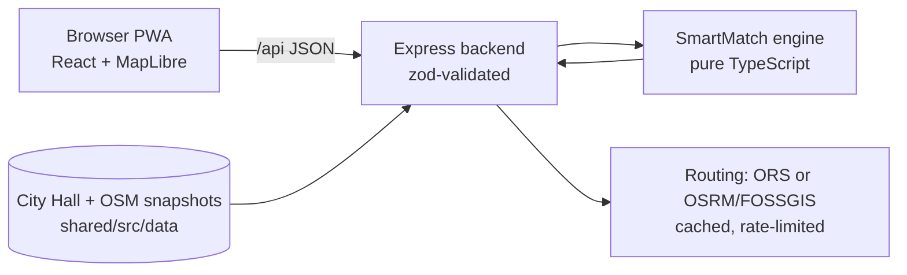

# VLAIQ FLOW

**Park smarter. Move greener.** A Romanian-first web app (PWA) for Timișoara that tells drivers *where to park* for a destination, what it costs, how far they walk, and when walking or cycling is the better choice. Built by team **VLAIQ** at UniHack 2026, Green Mobility track.

## The problem

Drivers reach the centre and circle looking for a space. That wastes time and fuel and adds traffic in the most crowded streets. Existing apps route you to the destination's door, not to a parking that makes sense for the whole trip.

VLAIQ FLOW compares **whole journeys**: drive to a specific parking, then walk to the destination. It ranks parkings with **SmartMatch**, a deterministic, unit-tested engine. Each pick comes with real Timpark tariffs, the walk and an estimated chance of a free space, and the app explains every number.

It extends what the city already runs instead of duplicating it:

- **Payment** goes to Timpark SMS or CityApp. We show the official SMS code and never take payments.
- **Problems in public space** go to Sesizări.
- **Live occupancy, traffic and transit arrivals** do not exist as open data, so we never present them as known.

## Try it in 2 minutes

Requirements: Node.js 20.11+ (22 recommended) and pnpm 12.18.0 (`corepack enable`).

```bash
pnpm install --frozen-lockfile
cp backend/.env.example backend/.env   # optional keys only; the app runs without them
pnpm dev
```

Open http://localhost:5173 and press **Încearcă DEMO**. The demo:

1. Sets a fixed start at Timișoara Nord station and Piața Victoriei as the destination.
2. Sets the arrival to the next weekday at 10:00, when Timpark charges. Even on a Sunday the comparison then shows real paid tariffs.
3. Shows the ranked parkings (**Unde parchezi**) with cost, walk and estimated chance of a space. **De ce pe locul 1?** opens the score breakdown.
4. Compares car + parking + walk with walking and cycling on real routes (**FLOW Smart Journey**).
5. Starts navigation: **Navighează până la parcare** → **Încearcă experiența DEMO**. The car follows the real route geometry. Speed can be set to 1×, 2× or 4×.
6. During the DEMO, **Simulează: parcarea s-a umplut** offers the next SmartMatch parking. Tap **Schimbă** and the new route is computed from the simulated position. The offer closes by itself after 15 s and keeps the current route.
7. On arrival, the app hands off to the walk to the destination.

On Windows, if PowerShell blocks scripts, use `start.cmd` or `pnpm.cmd`.

Also in the app:

- **Mișcare** records a walk or ride in the foreground with GPS plausibility checks and server-side evaluation. It awards virtual FLOW coins with no monetary value; choosing a green route alone never awards coins.
- **Provocări / Comunitate** show activity goals and a local, opt-in league preview.
- **Primărie** (FLOW City) shows public data coverage and a clearly labelled deterministic simulation of parking allocation.
- **Surse** lists every dataset with its source, date and limits.
- **/confidentialitate** lists where personal data goes.

## What is real, estimated, simulated or missing

| | Status | Source |
|---|---|---|
| Timpark zones, lots, paid streets, tariffs, SMS codes, schedule | **Real**, official | City Hall endpoint `cont.primariatm.ro/api/mobile/parking`, snapshot 13 Nov 2026 |
| Other parkings (malls, free lots) | **Real** locations; capacity and price often unknown | OpenStreetMap (ODbL) |
| Street register, landmarks, neighbourhoods | **Real** | City Hall snapshots, OpenStreetMap |
| Driving, walking and cycling routes | **Real** road geometry; never a straight line | openrouteservice if `ORS_API_KEY` is set, otherwise the public OSRM / FOSSGIS servers |
| Price of an OSM lot inside a paid Timpark zone | **Estimated** from the zone's tariff and labelled as such | Timpark zone tariff |
| Chance of a free space | **Estimated**: a rule model by area type, day and hour; not a measurement | `backend/src/engines/smartmatch/occupancy.ts` |
| DEMO origin, arrival time, "parking full" event and car movement | **Simulated**, labelled DEMO, per browser session | Never changes what other users see |
| Live occupancy, live traffic, transit arrivals, measured CO₂ savings | **Not available** | No open source exists; shown as unknown |
| AI assistant (Gemini), voice (ElevenLabs), analytics DB | **Not implemented** | Planned in `docs/spec.md` §6.11–6.14 |

Every price, availability and duration in the API carries a `quality` (`confirmed | estimated | unknown | simulated`) and a `source`.

## How SmartMatch ranks a parking

Each candidate gets a cost in minutes, and the lowest wins:

```text
cost = walk_min + (1 − p_free) × full_penalty + price × minutes_per_currency
```

The modes (**Echilibrat / Mai ieftin / Mai puțin mers**) change only the two weights. An unknown price is never treated as free. It counts as the most expensive price in the list and is flagged. The engine is a pure function with unit tests (`backend/src/engines/smartmatch`). Details are in `docs/spec.md` §7.

## Architecture



- **Monorepo:** `frontend` (React 18, Vite, Tailwind, MapLibre), `backend` (Node + Express + zod), `shared` (zod API contracts and data snapshots).
- **Secrets** stay on the backend. City Hall endpoints are called only by `scripts/` and snapshotted with their date, never on each user request.
- **Rate limits** are per IP. Snapshot reads allow 600 requests per minute, so a room of people on one Wi-Fi is fine. Routing endpoints allow 120 per minute.

## Configuration

| Variable | Where | Purpose |
|---|---|---|
| `API_PORT` | backend | API port, default 8787 |
| `CORS_ORIGINS` | backend | Allowed frontend origins, comma-separated |
| `ORS_API_KEY` | backend, optional | openrouteservice routes and walking/driving matrices |
| `VITE_API_URL` | frontend, public | Empty for same-origin `/api`; never put secrets here |
| `GEMINI_API_KEY`, `ELEVENLABS_API_KEY`, `DATABASE_URL` | backend, optional | Reserved for future integrations; nothing uses them yet |

Without `ORS_API_KEY`, driving uses the OSRM public demo, and walking and cycling use the FOSSGIS servers (`routing.openstreetmap.de`). These are low-volume services: the backend sends at most one FOSSGIS request per second with a User-Agent naming the team, caches results, and the map shows the OSM "fix the map" link their policy asks for. Set a key for anything beyond a demo.

ORS directions and matrices use `https://api.heigit.org/openrouteservice/v2/`. In Codex, bind the
`ORS_API_KEY` HTTP secret to `api.heigit.org`, preserve the inherited HTTPS proxy and CA trust, and
start Node 24 with `NODE_USE_ENV_PROXY=1`. The proxy supplies the credential for matching HTTPS
requests; never print the binding or put it in frontend variables. This cloud verification does not
configure the separate production server's credentials or network access.

## Verification

Live ORS/HeiGIT verification passed through Codex's secure HTTPS proxy on 14 Nov 2026 for driving,
walking, cycling and both parking matrices; see [the verification record](docs/ors-verification.md).
Automated tests use visibly labelled fixtures. Transit routing and a verified cycling overlay remain unavailable.

Mission 01 adds endpoint-snap validation for every directions entry point and safe provider diagnostics.
To repeat its opt-in live check in a correctly configured Codex Node 24 environment:

```bash
NODE_USE_ENV_PROXY=1 pnpm -F backend exec tsx ../scripts/verify-ors.ts
```

This starts a temporary real backend on port 18787, makes at most ten provider requests with bounded
deadlines and zero retries, validates complete journeys/matrices and checks cache reuse. It exits with
failure if any category is unavailable. Leave `NODE_USE_ENV_PROXY` unset in environments that do not
use an inherited HTTPS proxy. No public production deployment is implied.

```bash
pnpm typecheck
pnpm test
pnpm build
```

The browser scripts in `scripts/test-*-browser.cjs` need Playwright and Chromium. Set `PLAYWRIGHT_MODULE` and `CHROMIUM_PATH` if they are not installed globally. Some of these scripts use visibly labelled synthetic route fixtures. They test the interface, not provider access or a real walk.

## Data refresh

| Command | Purpose |
|---|---|
| `pnpm data:city` | Refresh the official Timpark, street register, landmark and neighbourhood snapshots, then restart the backend |
| `pnpm data:parkings` | Refresh the OSM parking snapshot |
| `pnpm data:osm-places` | Refresh named streets and major places from OSM |

## Deployment

The app is not deployed publicly yet. Hosting on **vlaiqflow.ro** is planned after the hackathon. The setup is one origin: Express serves the built frontend and `/api` behind Caddy with HTTPS.

```bash
pnpm build
NODE_ENV=production pnpm -F backend start
```

Use `deploy/Caddyfile.example` and set `FLOW_DOMAIN` and `CORS_ORIGINS`. GPS on a phone needs HTTPS. Before a public launch:

- Fill in the data controller and contact in `privacyContact` (`shared/src/brand.ts`); the `/confidentialitate` page shows a visible gap until then.
- Keep `backend/.data` (the prototype wallet ledger) private and persistent.

## Who could run it

Possible operators include Timpark for parking operations and the City Hall's digital and mobility teams as a CityApp feature. This is a proposal: there is no partnership. Handover notes are in `docs/city-handover.md`.

## License

Code: [MIT](LICENSE). Data and assets keep their own terms: OpenStreetMap is ODbL, Natural Earth is public domain, fonts are OFL, and npm packages keep their notices. See `docs/third-party.md`.

More documentation: [specification](docs/spec.md), [jury demo runbook](docs/jury-demo.md), [navigation](docs/navigation.md), [Green Switch](docs/green-switch.md), [Motion and privacy](docs/motion.md), [themes](docs/themes.md).
