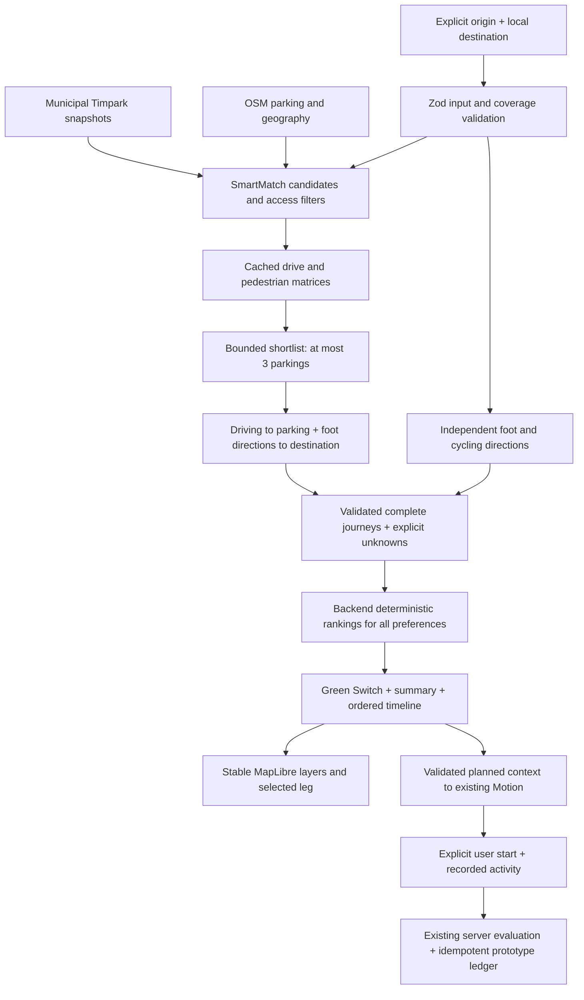

# NetRom — Glue It Together: FLOW Smart Journey

Status: implemented orchestration and tested integration. External end-to-end routing verification is
**BLOCKED** in this cloud environment. This is engineering evidence, not an award or eligibility claim.
Sponsor wording comes from the team-supplied challenge screenshots; fresh official-site access failed.

## Problem and resulting behavior

A driver wants to reach a destination, not merely the destination's road coordinate. A parking dataset
cannot provide a door-to-door path. A driving router does not choose parking or calculate the final walk.
A fitness tracker does not compare real mobility choices. FLOW feeds each component's useful output into
the next: municipal/OSM parking → SmartMatch shortlist → properly profiled directions → ordered complete
journey → deterministic comparison → leg-aware map/timeline → planned active-mode handoff to Motion.

## Actual components and data

| Component | Meaningful contribution | Evidence |
|---|---|---|
| Primăria Timișoara Timpark snapshot | Actual lot/street geometry, tariff context and schedule | `shared/src/data/timpark.json`, snapshot 13 Nov 2026, version d014276a755c |
| OSM parking/local geography | Attributed additional parking and municipal name matching | committed ODbL snapshots, `parkingStore`, `destinations` |
| ORS driving/foot/cycle adapters | Correctly profiled geometry and metrics, backend-only credential | `routing.ts`, `journeys.ts`, `activeRouting.ts`; deterministic provider tests; live check blocked |
| SmartMatch | Candidate discovery, access filtering, price and walking shortlist | reused engine; unknown-price/access/dedup regressions |
| Complete orchestrator | Connects parking output to each driving/foot input and exact leg totals | `completeJourneys.ts`, real local HTTP integration tests |
| MapLibre | Maps the actual selected leg geometries and parking location | `journeyLayers.ts`, browser emphasis/style/resize tests |
| Motion | Converts intended active travel into an explicit recording opportunity | validated planned context; zero selection rewards; existing wallet tests |

No unrelated AI API or provider-logo wall was added. Municipal endpoints remain snapshotted, not queried
for every judge. OSM attribution and font OFL notices are retained. No GPS trace is exported to FLOW City.

## Reproducible verification

`POST /api/journeys/complete` uses one shared strict contract. Run `pnpm typecheck`, `pnpm test`, `pnpm build`.
The local HTTP test mounts the real Express router and injects explicitly synthetic provider responses.
It checks simultaneous request coalescing, complete drive → park → walk order, unknown occupancy and
input/coverage rejection. Service tests check exact sums, restricted parking, walking limits, invalid
profile/geometry, partial modes, currency representation and deterministic preference thresholds.

`node scripts/test-smart-journey-browser.cjs` exercises the actual missing-provider state, then visibly
synthetic routed responses: parking summary, timeline selection, map emphasis, Green Switch without new
provider calls, five viewport widths, theme retention, Romanian fonts, reduced motion, Motion handoff,
no selection reward and stale response rejection. Browser viewport screenshots are not physical-device tests.

See [Sprint report](../sprint-01-report.md) for final executed results and [complete contracts](../complete-journeys.md).

## Failure behavior and honest limits

- Missing origin never silently becomes a demo position.
- Missing ORS means active and complete car routes are unavailable; parking discovery remains available.
- One rejected candidate/category does not erase other valid routes.
- No guessed walking polyline, traffic data, available spaces or parking-search zero is substituted.
- Costs are orientative where calculated from tariffs; unknown price is not free. Fuel/total cost unknown.
- Public OSRM is only the existing low-volume driving fallback, never a bicycle/foot provider.
- This environment has no ORS key; attempted external HTTPS connections received proxy 403. **REAL PROVIDER
  VERIFICATION BLOCKED.** Synthetic tests do not prove a live service connection.
- Cycling infrastructure/GTFS full transit routing and real human usability feedback are not claimed.

## Jury sequence

Follow [the demo runbook](../demo-smart-journey.md). On a provisioned provider, search Piața Victoriei,
choose an explicit origin, inspect auto→parking→walk, switch to cycling, select its timeline leg, open
Motion and verify that selection alone did not change the wallet. If provider access is unavailable,
show the actual unavailable state and label the synthetic browser test as a **test**. Never pitch a
fixture as a successful real-world trip.
