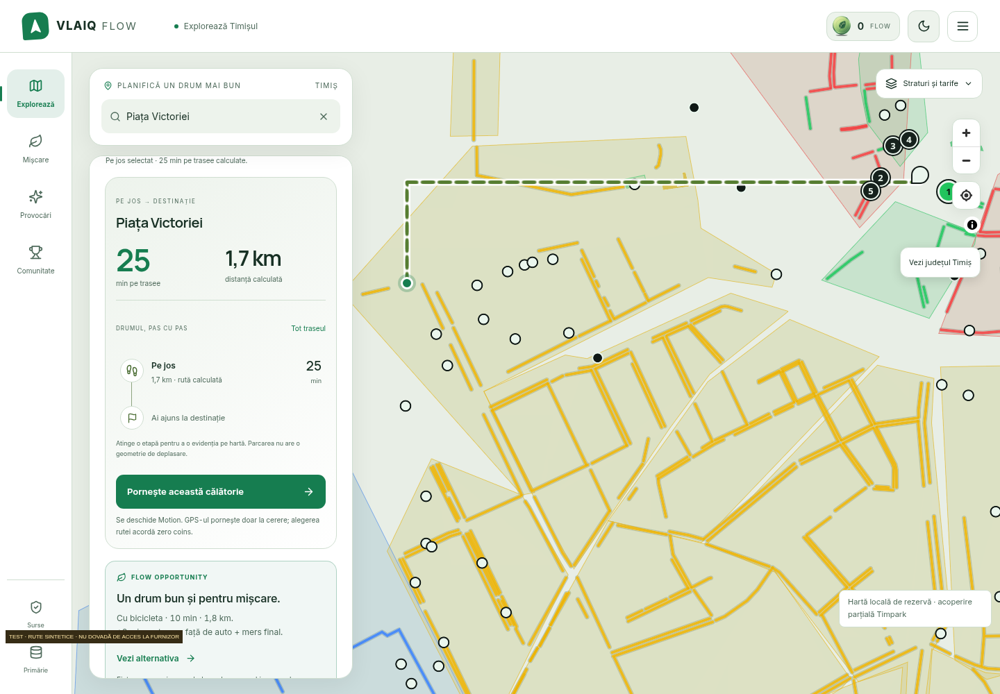
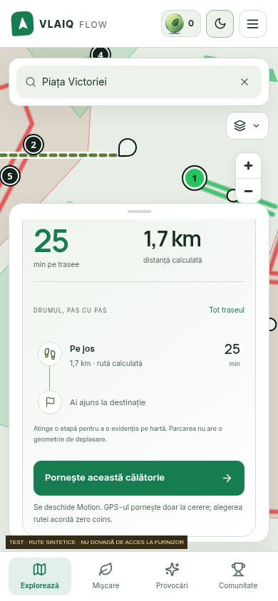
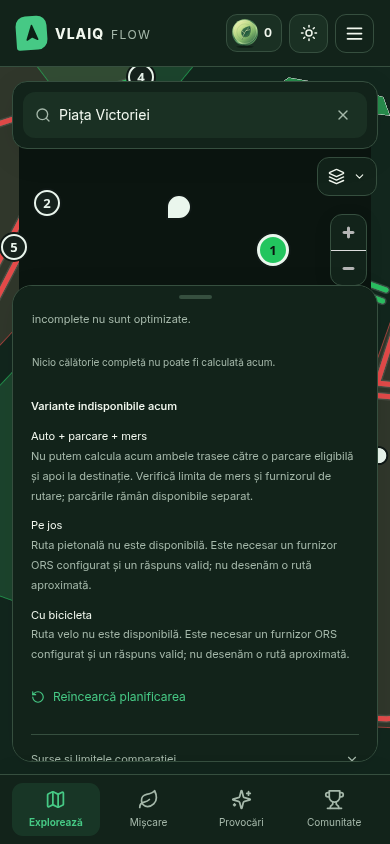

# Browser evidence

`desktop-synthetic.png` and `mobile-synthetic.png` use explicit synthetic routing fixtures and carry
visible test stamps. They show the actual integrated UI over the actual partial municipal map fallback.
They are not evidence of external routing, route safety, physical-phone testing or a real journey.

`provider-unavailable-real.png` is the actual running backend's unavailable result without an ORS key.
Captured with `scripts/test-smart-journey-browser.cjs`, 14 November 2026. Further viewports/states are
in the execution workspace's `/workspace/artifacts/smart-journey/`.

